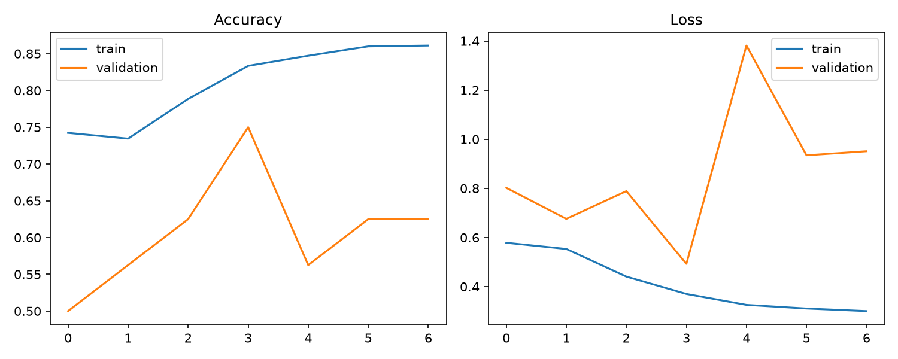
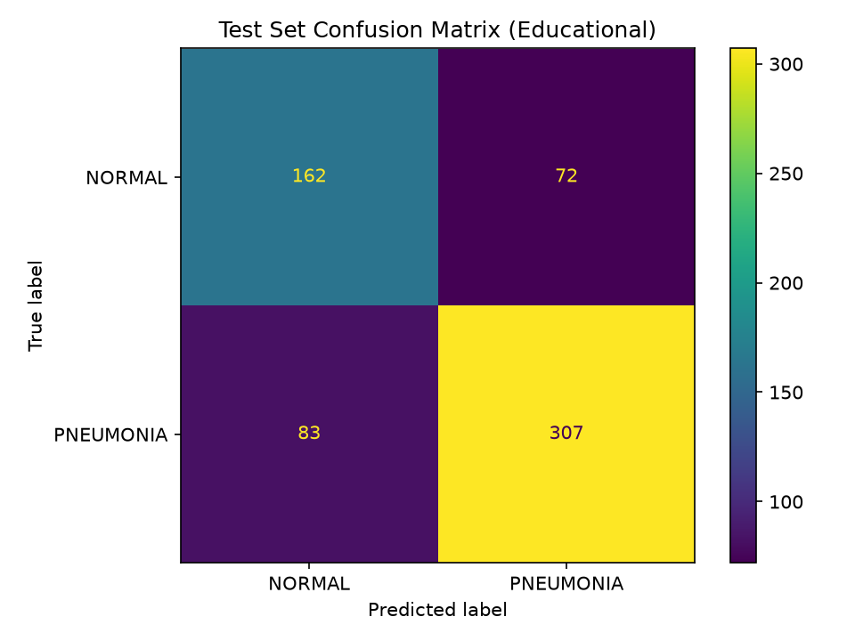
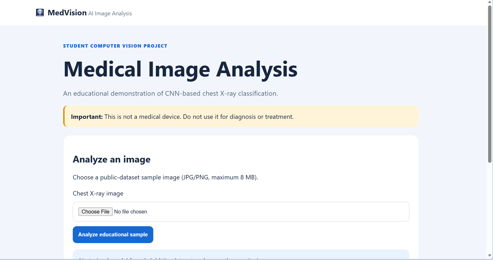
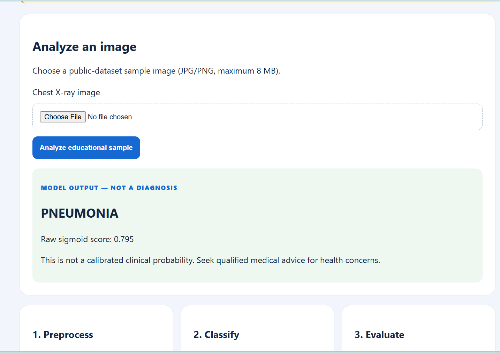
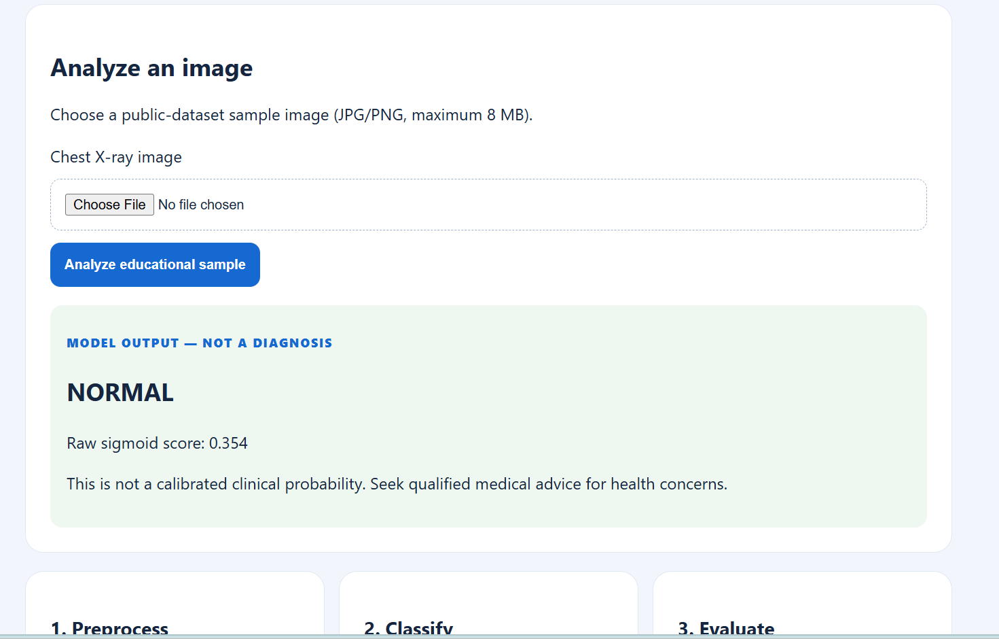

# 🩻 MedVision — AI-Powered Medical Image Analysis System

An educational computer vision project that classifies chest X-ray images into **NORMAL** and **PNEUMONIA** categories using a Convolutional Neural Network (CNN), TensorFlow/Keras, and Flask.

> ⚠️ **Disclaimer:** This project is for educational and demonstration purposes only. It is not a medical device, is not clinically validated, and must not be used to diagnose or treat any medical condition. Model predictions can be incorrect.

## ✨ Features

* Binary chest X-ray image classification: NORMAL vs PNEUMONIA
* Image resizing to 256 × 256 pixels
* Grayscale image preprocessing and normalization
* CNN model training with validation and early stopping
* Test-set evaluation using accuracy, precision, recall, and F1-score
* Confusion matrix and training performance graphs
* Flask-based web interface for uploading and analyzing images
* Input validation and automated tests

## 🛠️ Technology Stack

* **Language:** Python
* **Deep Learning:** TensorFlow / Keras
* **Image Processing:** OpenCV, Pillow
* **Data Processing:** NumPy
* **Visualization:** Matplotlib
* **Evaluation:** Scikit-learn
* **Web Framework:** Flask
* **Testing:** Pytest

## 📁 Project Structure

```text
AI-Medical-Image-Analysis/
├── app.py
├── requirements.txt
├── README.md
├── data/
│   └── chest_xray/
│       ├── train/
│       ├── val/
│       └── test/
├── models/
│   └── medical_image_cnn.keras
├── outputs/
│   ├── training_history.json
│   ├── training_curves.png
│   ├── evaluation_metrics.json
│   └── confusion_matrix.png
├── screenshots/
├── src/
│   ├── data_utils.py
│   ├── train.py
│   └── evaluate.py
├── templates/
├── static/
├── tests/
└── docs/
```

*Note: Dataset images and the trained model may be kept locally rather than committed to GitHub.*

## 📊 Model Evaluation

The model was evaluated on **624 test images**.

| Metric    | NORMAL | PNEUMONIA |
| --------- | -----: | --------: |
| Precision | 66.12% |    81.00% |
| Recall    | 69.23% |    78.72% |
| F1-score  | 67.64% |    79.84% |

**Overall test accuracy: 75.16%**

The model performed better on the PNEUMONIA class than on the NORMAL class according to these reported metrics.

These results describe performance on this particular dataset. They do not establish clinical reliability or suitability for medical decision-making.

## 📈 Training Curves

Training and validation accuracy/loss are visualized in the following graph.



## 🔎 Confusion Matrix

The confusion matrix summarizes correct and incorrect classifications on the test dataset.



## 🖥️ Application Screenshots

### Home Page



### Pneumonia Prediction



### Normal Prediction



## 📦 Dataset Setup

Use a publicly available chest X-ray dataset only after reviewing its license and terms.

The expected directory structure is:

```text
data/chest_xray/
├── train/
│   ├── NORMAL/
│   └── PNEUMONIA/
├── val/
│   ├── NORMAL/
│   └── PNEUMONIA/
└── test/
    ├── NORMAL/
    └── PNEUMONIA/
```

The dataset is not included in this repository. Do not commit dataset images, private medical information, or patient data.

## ⚙️ Installation — Windows

Open PowerShell in the project directory.

Create a virtual environment:

```powershell
py -m venv .venv
```

Activate it:

```powershell
.\.venv\Scripts\Activate.ps1
```

Install the dependencies:

```powershell
python -m pip install -r requirements.txt
```

## 🧠 Train the Model

After downloading and organizing the dataset, run:

```powershell
python src/train.py
```

The training script saves the trained model and training artifacts.

## 📋 Evaluate the Model

Run:

```powershell
python src/evaluate.py
```

The evaluation script generates:

* `outputs/evaluation_metrics.json`
* `outputs/confusion_matrix.png`

## 🌐 Run the Web Application

Start Flask:

```powershell
python app.py
```

Open this address in your browser:

```text
http://127.0.0.1:5000
```

Upload a supported public-dataset sample image to test the educational classification workflow.

## 🧪 Run Automated Tests

Run:

```powershell
pytest -v
```

## 🔄 Project Workflow

1. Collect labelled public chest X-ray images.
2. Resize and preprocess the images.
3. Train the CNN on the training dataset.
4. Monitor performance on the validation dataset.
5. Evaluate the trained model on the test dataset.
6. Save evaluation metrics and visualizations.
7. Load the model in the Flask application.
8. Upload an image and display the model's educational output.

## ⚠️ Limitations

* This is a binary classification demonstration, not a complete medical image analysis system.
* The dataset may contain class imbalance and source-specific biases.
* Performance may vary on images from different sources.
* The model has not undergone clinical validation.
* The raw sigmoid score is not a calibrated clinical probability.
* Accuracy alone is insufficient to assess model performance.
* Predictions must not be used for diagnosis or treatment.

---

**MedVision — Learn, Experiment, and Explore Computer Vision Responsibly.**
